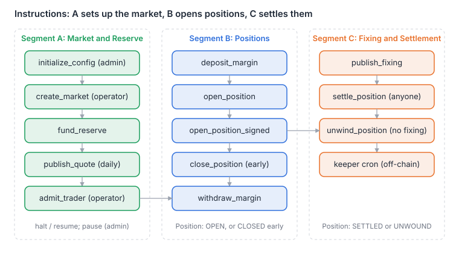
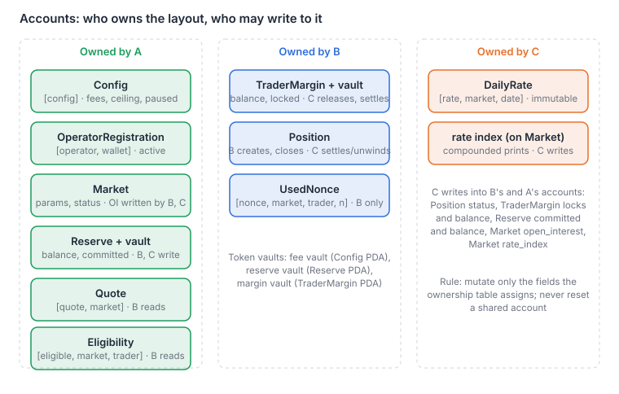
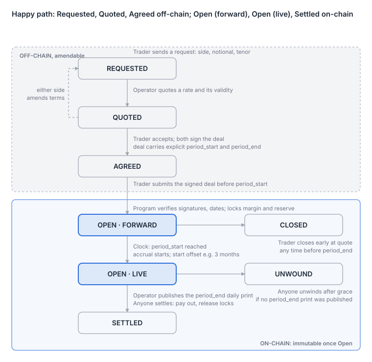
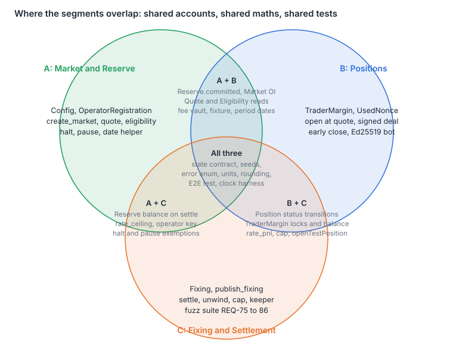

# Saphire — on-chain Forward Rate Agreements on Solana

Turbin3 Q4 2026 Builders Cohort capstone · Category: Real World Assets

Saphire lets an eligible trader enter a **forward rate agreement (FRA) on a real-world interest rate** against a single operator who quotes from its own inventory, and settles the one resulting cashflow in USDC when the rate is known. It is a *prop AMM* in the market-making sense: operator inventory, index-anchored, program-computed quote — no pooled LPs, no curve on-chain.

**v1 market:** USD · SOFR compounded in arrears · 3×6 · ACT/360 · Modified Following · settled undiscounted at maturity. The operator publishes each day's SOFR print on-chain; the program compounds them into a **rate index**, and the floating rate for any period is derived from two index checkpoints — every settlement input is on-chain and recomputable.

```
settlement = N × (L − K) × τ        τ = actual days / 360
```
capped at the losing side's locked amount. Pay-fixed gains when the floating rate L ends above the agreed rate K; receive-fixed gains when it ends below.

> **Two rates.** The **fixed rate K** is set per position at open (from the quote, or the RFQ deal) and stored in `Position.fixed_rate`. The **floating rate L** for a period is derived at settlement from the daily rate index: `L = (index(period_end) / index(period_start) − 1) × 360 / days`. Nothing publishes L directly; the operator publishes daily prints (`DailyRate`), the program compounds them.

## Roles

| Role | Does | Does not |
| --- | --- | --- |
| **Admin** (`Config.authority`) | initialize/update config (fees, rate ceiling), register operators, pause/resume the program | create markets, admit traders, touch margin or positions |
| **Operator** | create and control its market: fund/withdraw reserve, publish the daily quote and the daily SOFR print, admit/suspend traders, halt/resume, sign RFQ deals | change fees, settle, alter a position |
| **Trader** | deposit/withdraw USDC margin, open at quote or from a signed RFQ deal, close early | anything on the market or reserve |
| **Anyone** (crank) | `settle_position`, `unwind_position` | anything else |

## Instructions by segment

Three segments, three owners, dependencies A → B → C.



| Segment | Owner | Instructions |
| --- | --- | --- |
| **A — Market & Reserve** | Ritam | `initialize_config`, `update_config`, `register_operator`, `deactivate_operator` (admin) · `create_market`, `fund_reserve`, `withdraw_reserve`, `publish_quote`, `admit_trader`, `suspend_trader`, `halt_market`, `resume_market` (operator) · `pause_program`, `resume_program` (admin) |
| **B — Positions** | Liam | `init_trader_margin`, `deposit_margin`, `withdraw_margin`, `open_position`, `open_position_signed`, `close_position` (trader) · shared `fra_math` crate |
| **C — Daily Rates & Settlement** | Greg | `publish_daily_rate` (operator) · `settle_position`, `unwind_position` (anyone) · keeper cron · fuzz suite for the cross-cutting rules |

## Accounts

One owning segment per account defines the layout; the ownership table in the implementation guide says which fields other segments may write.



| Account | Seeds | Purpose |
| --- | --- | --- |
| `Config` | `["config"]` | authority, protocol fee bps, fee vault, rate ceiling, paused |
| `OperatorRegistration` | `["operator", operator]` | admin allowlist of operators |
| `Market` | `["market", benchmark_id, mint, start_offset, tenor]` | conventions, risk parameters, status, open interest, position counter, current rate index |
| `Reserve` (+ vault) | `["reserve", market]` | operator inventory: balance, committed |
| `Quote` | `["quote", market]` | fixed mid, half-spread, size cap, published_at, epoch |
| `Eligibility` | `["eligible", market, trader]` | per-market whitelist |
| `TraderMargin` (+ vault) | `["margin", market, trader]` | balance, locked; free = balance − locked |
| `Position` | `["position", market, trader, position_count]` | the FRA: side, N, K, period dates, locks, status |
| `UsedNonce` | `["nonce", market, trader, nonce]` | replay protection for signed deals |
| `DailyRate` | `["rate", market, date]` | one SOFR print per business day with the compounded index checkpoint, immutable |

Units: amounts are USDC base units (u64); rates are u64 scaled 10⁴ per percent (4.0700% = 40700, 1 bp = 100); bps are u16; dates are Unix seconds; locks/commits/fees round up, PnL truncates toward zero — all in `fra_math`.

## Order lifecycle

RFQ negotiation and amendments happen off-chain as signed messages; the chain sees only the agreed deal (or a program-priced open with no RFQ). Once Open a deal is live and unamendable. Forward and Live are phases of one stored status, split by the clock at `period_start`.



| State | Where | Leaves by |
| --- | --- | --- |
| REQUESTED → QUOTED → AGREED | off-chain | trader submits the signed deal before `period_start` |
| OPEN · FORWARD | on-chain | clock reaches `period_start`; or trader closes early → CLOSED |
| OPEN · LIVE | on-chain | period_end print published and anyone settles → SETTLED; early close → CLOSED; no print after grace → UNWOUND |
| SETTLED / CLOSED / UNWOUND | terminal | — |

## Where the segments overlap

Every shared thing needs an agreed interface before either side codes it; the shared state contract is frozen and tagged before any instruction is written.



## What is on-chain and what is not

| On-chain | Off-chain |
| --- | --- |
| the accounts above; executable quote (mid ± spread, size, freshness); deal verification; locks, commitments, fees, settlement arithmetic and caps; daily prints and the compounded rate index | RFQ negotiation; the operator's pricing engine and hedging book (closed); daily SOFR print cron (reads the NY Fed publication); keeper cron for settle/unwind; indexer |

## Open design question

`open_position_signed` currently verifies a detached operator Ed25519 signature over the Borsh-encoded deal via the Instructions sysvar. Under review: make the operator a **co-signer of the trader's transaction** instead — one transaction, runtime-verified, no signature parsing, no `UsedNonce` account. See the decision log.

## Documents

- Program Implementation Guide (Segments A, B, C): requirements, shared state contract, instruction cards, traceability, per-segment implementation detail with flow diagrams for every instruction.
- Section 2: Process Log — first drafts, self-check, red-team decisions.
- Meeting notes and decision matrix (14 decisions).

Markdown copies of these will live under `docs/` as they are finalised.

## Repository layout (planned)

```
programs/saphire/        Anchor program (segments A, B, C as modules)
crates/fra_math/         shared pricing, date and rounding helpers
tests/                   Rust LiteSVM tests: unit (one instruction, mocked state), integration (flows, lifecycle E2E)
keeper/                  settle/unwind cron and daily SOFR print script
docs/                    this README's diagrams and the markdown docs
```

## License

MIT — see [LICENSE](LICENSE). The on-chain program, generated client, keeper and tests are open source; an operator's pricing engine is its own.
