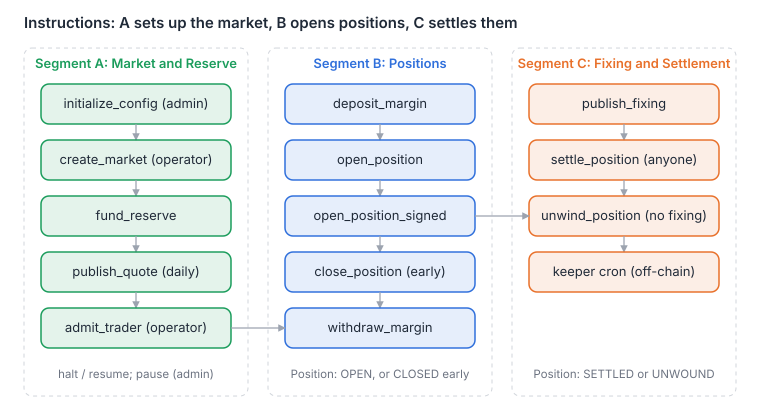
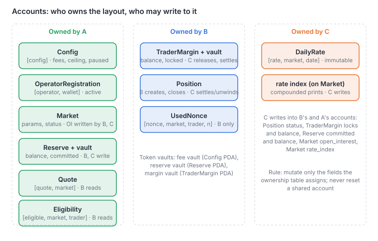

# Saphire — Implementation Guide

Instruction cards and account cards for the FRA program. Read the two maps, then the account cards once, then the instruction cards — each card refers to accounts by name and never repeats their layout.

**Labels used on cards**

| Label | Meaning |
| --- | --- |
| `A` `B` `C` | Owning segment: A Market & Reserve (Ritam) · B Positions (Liam) · C Daily Rates & Settlement (Greg) |
| `admin` `operator` `trader` `anyone` | Who signs |
| `R` `W` `INIT` `CLOSE` | How the instruction touches an account: read · write · create · close |
| `K` / `L` | Fixed rate agreed per position at open / realised floating rate for the period, derived on-chain from the daily rate index: `L = (index_end / index_start − 1) × 360 / days` |
| `REQ-nn` | Requirement implemented (see Part 0 of the Program Implementation Guide) |
| `halt-ok` `pause-ok` | Allowed while the market is Halted / the program is Paused |

**Conventions**: amounts u64 in USDC base units · rates u64 scaled 10⁴ per percent (1 bp = 100) · bps u16 · dates i64 Unix seconds · every PDA stores `bump` · all arithmetic checked · rounding only in `fra_math` (locks, commits, fees ceil; PnL truncates toward zero).

---

## Maps





| Instruction | ID | Segment | Signer | Creates | Writes |
| --- | --- | --- | --- | --- | --- |
| initialize_config | IX-01 | A | admin | Config, fee_vault | — |
| update_config | IX-02 | A | admin | — | Config |
| register_operator | IX-03 | A | admin | OperatorRegistration | — |
| deactivate_operator | IX-04 | A | admin | — | OperatorRegistration |
| create_market | IX-05 | A | operator | Market, Reserve, reserve_vault, Quote | — |
| fund_reserve | IX-06 | A | operator | — | Reserve, reserve_vault |
| withdraw_reserve | IX-07 | A | operator | — | Reserve, reserve_vault |
| publish_quote | IX-08 | A | operator | — | Quote |
| admit_trader | IX-09 | A | operator | Eligibility | Eligibility |
| suspend_trader | IX-10 | A | operator | — | Eligibility |
| init_trader_margin | IX-11 | B | trader | TraderMargin, margin_vault | — |
| deposit_margin | IX-12 | B | trader | — | TraderMargin, margin_vault |
| halt_market / resume_market | IX-13/14 | A | operator | — | Market |
| pause_program / resume_program | IX-15/16 | A | admin | — | Config |
| withdraw_margin | IX-17 | B | trader | — | TraderMargin, margin_vault |
| open_position | IX-18 | B | trader | Position | TraderMargin, Reserve, Market, fee_vault |
| open_position_signed | IX-19 | B | trader (+ operator signature) | Position, UsedNonce | TraderMargin, Reserve, Market, fee_vault |
| close_position | IX-20 | B | trader | — | Position, TraderMargin, Reserve, Market, both vaults |
| publish_daily_rate | IX-21 | C | operator | DailyRate | Market (rate_index, last_rate_date) |
| settle_position | IX-22 | C | anyone | — | Position, TraderMargin, Reserve, Market, both vaults |
| unwind_position | IX-23 | C | anyone | — | Position, TraderMargin, Reserve, Market |
| close_used_nonce | IX-24 | B/C | trader | — | UsedNonce (close) |

---

## Account cards

### Config `A`
- **Seeds** `[b"config"]` · one per program
- **Created by** IX-01 · **Written by** IX-02, IX-15, IX-16 · **Read by** IX-18, IX-19 (paused, fee, fee_vault), IX-08, IX-21 (rate_ceiling)
```rust
pub struct Config { pub authority: Pubkey, pub protocol_fee_bps: u16, pub fee_vault: Pubkey, pub rate_ceiling: u64, pub paused: bool, pub bump: u8 }
```
- `fee_vault`: token account, authority = Config PDA, mint = settlement mint

### OperatorRegistration `A`
- **Seeds** `[b"operator", operator]`
- **Created by** IX-03 · **Written by** IX-04 · **Read by** IX-05 (`active`)
```rust
pub struct OperatorRegistration { pub operator: Pubkey, pub active: bool, pub bump: u8 }
```

### Market `A`
- **Seeds** `[b"market", benchmark_id, settlement_mint, start_offset_months, tenor_months]`
- **Created by** IX-05 · **Written by** IX-13/14 (`status`); IX-18/19/20 and IX-22/23 (`open_interest`); IX-18/19 (`position_count`); IX-21 (`rate_index`, `last_rate_date`) · **Read by** everything else
```rust
pub struct Market {
    pub operator: Pubkey, pub keeper: Pubkey, pub benchmark_id: u8, pub settlement_mint: Pubkey,
    pub start_offset_months: u8, pub tenor_months: u8, pub day_count_basis: u16, pub business_day_convention: u8,
    pub initial_margin_bps: u16, pub operator_commit_bps: u16, pub min_notional: u64, pub max_notional: u64,
    pub open_interest_cap: u64, pub open_interest: u64, pub quote_validity_secs: u32, pub rate_grace_days: u16,
    pub early_close_fee_bps: u16, pub max_half_spread_bps: u16, pub status: MarketStatus, pub position_count: u64,
    pub rate_index: u128, pub last_rate_date: i64, pub bump: u8,
}
pub enum MarketStatus { Active, Halted, Closed }
```

### Reserve `A` (+ `reserve_vault`)
- **Seeds** `[b"reserve", market]` · vault: token account, authority = Reserve PDA
- **Created by** IX-05 · **Written by** IX-06/07 (`balance`); IX-18/19 (`committed` +); IX-20, IX-22, IX-23 (`committed` −, `balance` ±)
```rust
pub struct Reserve { pub market: Pubkey, pub vault: Pubkey, pub balance: u64, pub committed: u64, pub bump: u8 }
```
- Invariant: `balance == reserve_vault.amount` after every transfer; `withdrawable = balance − committed`

### Quote `A`
- **Seeds** `[b"quote", market]` · overwritten on each publish
- **Created by** IX-05 · **Written by** IX-08 · **Read by** IX-18, IX-20
```rust
pub struct Quote { pub market: Pubkey, pub fixed_mid: u64, pub half_spread_bps: u16, pub max_notional_at_quote: u64, pub published_at: i64, pub epoch: u64, pub bump: u8 }
```
- Fresh when `now − published_at <= market.quote_validity_secs` and `epoch > 0`

### Eligibility `A`
- **Seeds** `[b"eligible", market, trader]`
- **Created by** IX-09 · **Written by** IX-09 (re-admit), IX-10 · **Read by** IX-11, IX-12, IX-18, IX-19 — never by withdraw, close, settle, unwind
```rust
pub struct Eligibility { pub market: Pubkey, pub trader: Pubkey, pub active: bool, pub bump: u8 }
```

### TraderMargin `B` (+ `margin_vault`)
- **Seeds** `[b"margin", market, trader]` · vault: token account, authority = TraderMargin PDA
- **Created by** IX-11 · **Written by** IX-12, IX-17 (`balance`); IX-18/19 (`locked` +, `balance` − fee, `open_positions` +); IX-20, IX-22, IX-23 (`locked` −, `balance` ±, `open_positions` −)
```rust
pub struct TraderMargin { pub market: Pubkey, pub trader: Pubkey, pub vault: Pubkey, pub balance: u64, pub locked: u64, pub open_positions: u32, pub bump: u8 }
```
- `free() = balance − locked`; invariant `balance == margin_vault.amount`

### Position `B`
- **Seeds** `[b"position", market, trader, position_count_le]`
- **Created by** IX-18, IX-19 · **Written by** IX-20 (→ Closed), IX-22 (→ Settled), IX-23 (→ Unwound) · never closed in v1
```rust
pub struct Position {
    pub market: Pubkey, pub trader: Pubkey, pub nonce: u64, pub side: Side, pub notional: u64, pub fixed_rate: u64,
    pub trade_date: i64, pub period_start: i64, pub period_end: i64, pub day_count_days: u16,
    pub locked_margin: u64, pub committed_reserve: u64, pub fee_paid: u64, pub origin: Origin,
    pub status: PositionStatus, pub settled_amount: i64, pub settled_at: i64, pub bump: u8,
}
pub enum Side { PayFixed, ReceiveFixed }
pub enum Origin { Quote, Rfq }
pub enum PositionStatus { Open, Closed, Settled, Unwound }
```
- Terms (`side, notional, fixed_rate, period_*`) never change after creation (REQ-82); status only moves Open → terminal (REQ-84)

### UsedNonce `B`
- **Seeds** `[b"nonce", market, trader, nonce_le]`
- **Created by** IX-19 · **Closed by** IX-24 (optional) · replay protection for signed deals. *Dropped entirely if IX-19 moves to the co-signer design (see IX-19).*
```rust
pub struct UsedNonce { pub market: Pubkey, pub trader: Pubkey, pub nonce: u64, pub position: Pubkey, pub bump: u8 }
```

### DailyRate `C`
- **Seeds** `[b"rate", market, date_le]` · one per business day per market · `date` is 00:00 UTC of the print's calendar day
- **Created by** IX-21 · never written again (REQ-83) · **Read by** IX-22 (two checkpoints: period_start and period_end); the *absence* of the period_end checkpoint is checked by IX-23
```rust
pub struct DailyRate {
    pub market: Pubkey,
    pub date: i64,            // 00:00 UTC of the business day
    pub rate: u64,            // SOFR print, scaled 10⁴ per percent
    pub days_applied: u8,     // calendar days this print accrues for (1; 3 over a weekend; more over holidays)
    pub index_before: u128,   // Market.rate_index when this print was applied
    pub index_after: u128,    // index_before × (1 + rate × days_applied / 360), scale 10¹⁸
    pub published_at: i64,
    pub bump: u8,
}
```
- The **rate index** is a cumulative compounding factor, scale 10¹⁸, starting at 10¹⁸ when the market is created. `Market.rate_index` and `Market.last_rate_date` mirror the latest checkpoint.
- Prints must be sequential: `date == next business day after Market.last_rate_date` (gaps refused); several days may be published in one transaction by repeating the instruction.
- `L` for a position = `(index_after(period_end) × 10¹⁸ / index_after(period_start) − 10¹⁸) × 360 / days`, computed by `fra_math::period_rate_from_index`. Every input is on-chain; anyone can recompute.

### `fra_math` (crate, `B` owns, all call)

| fn | Rule |
| --- | --- |
| `compute_fixed_rate(mid, half_spread_bps, side) -> u64` | PayFixed `mid + bps·100`; ReceiveFixed `mid − bps·100` |
| `bps_ceil(amount, bps) -> u64` | `ceil(amount · bps / 10_000)` in u128 |
| `year_fraction_days(start, end) -> u16` | `(end − start) / 86_400`, > 0 |
| `rate_pnl(notional, rate_a, rate_b, days) -> i128` | `notional · (rate_a − rate_b) · days / (10⁶ · 360)`, divide last, truncate toward zero |
| `derive_period(ts, offset_m, tenor_m, cal) -> (i64, i64)` | add months, Modified Following each date; `cal` trait, weekend-only in v1 |
| `next_business_day(date, cal) -> i64` and `days_until(date, next) -> u8` | sequencing and `days_applied` for daily prints |
| `compound_index(index_before: u128, rate: u64, days_applied: u8) -> u128` | `index × (10¹⁸ + rate × days_applied × 10¹⁸ / (10⁶ × 360)) / 10¹⁸`, u256 intermediate via `ruint` or two-limb mul, truncate |
| `period_rate_from_index(index_start: u128, index_end: u128, days: u16) -> u64` | `((index_end × 10¹⁸ / index_start) − 10¹⁸) × 360 × 10⁶ / (days × 10¹⁸)`, truncate; result scaled 10⁴ per percent |

---

## Instruction cards — Segment A

Each card: header labels → **Accounts** (name · access · constraint) → **Validation** (what the account struct cannot express) → **Logic** → **Errors**.

### IX-01 `initialize_config(protocol_fee_bps: u16, rate_ceiling: u64)` `A` `admin`
Implements: parameters for REQ-02a, 16, 33, 55

**Accounts**
- `authority` · signer, payer
- `config` · INIT · seeds `[b"config"]`
- `fee_vault` · INIT token · authority = config, mint = settlement_mint
- `settlement_mint`, `token_program`, `system_program`

**Validation** · `protocol_fee_bps <= MAX_FEE_BPS` · `rate_ceiling > 0`

**Logic** · write fields, `paused = false` · emit `ConfigInitialized`

**Errors** · `InvalidParams`

### IX-02 `update_config(protocol_fee_bps?: u16, rate_ceiling?: u64)` `A` `admin` *(optional)*
Implements: REQ-02a

**Accounts** · `authority` signer, `config.authority == authority` · `config` W

**Validation** · as IX-01 bounds

**Logic** · overwrite provided fields · emit `ConfigUpdated`

**Errors** · `NotAuthority`, `InvalidParams`

### IX-03 `register_operator()` `A` `admin`
Implements: REQ-02b

**Accounts** · `authority` signer, payer, `config.authority == authority` · `config` R · `operator` unchecked wallet · `operator_registration` INIT seeds `[b"operator", operator]` · `system_program`

**Validation** · none

**Logic** · write `operator`, `active = true` · emit `OperatorRegistered`

**Errors** · `NotAuthority`

### IX-04 `deactivate_operator()` `A` `admin`
Implements: REQ-02b, 02c

**Accounts** · `authority` signer, `config.authority == authority` · `config` R · `operator_registration` W, seeds `[b"operator", registration.operator]`

**Validation** · `active == true`

**Logic** · `active = false`; account kept; existing markets untouched · emit `OperatorDeactivated`

**Errors** · `NotAuthority`, `OperatorInactive`

### IX-05 `create_market(params: MarketParams, keeper: Pubkey)` `A` `operator`
Implements: REQ-01–06

**Accounts**
- `operator` · signer, payer
- `config` R
- `operator_registration` R · seeds `[b"operator", operator]` · `constraint = active`
- `settlement_mint`
- `market` INIT · seeds `[b"market", params.benchmark_id, settlement_mint, params.start_offset_months, params.tenor_months]`
- `reserve` INIT · seeds `[b"reserve", market]`
- `reserve_vault` INIT token · authority = reserve, mint = settlement_mint
- `quote` INIT · seeds `[b"quote", market]`
- `token_program`, `system_program`

**Validation**
- `initial_margin_bps > 0 && operator_commit_bps > 0` (REQ-04)
- `min_notional <= max_notional` (REQ-05)
- `benchmark_id`, `day_count_basis`, `business_day_convention` in supported set
- `open_interest_cap`, `quote_validity_secs`, `rate_grace_days`, `max_half_spread_bps` > 0

**Logic**
1. Write Market: `operator = signer`, `keeper`, params, `status = Active`, `open_interest = 0`, `position_count = 0`, `rate_index = 10¹⁸`, `last_rate_date = params.index_start_date` (the business day before the first print)
2. Reserve: `market`, `vault = reserve_vault`, `balance = committed = 0`
3. Quote: `market`, zeroed, `epoch = 0` (unpublished)
4. Emit `MarketCreated`

**Errors** · `OperatorInactive` (REQ-02/02c), `MarketExists` (init, REQ-03), `InvalidParams`

### IX-06 `fund_reserve(amount: u64)` `A` `operator` `halt-ok` `pause-ok`
Implements: REQ-07, 08

**Accounts** · `operator` signer, `market.operator == operator` · `market` R · `reserve` W, `has_one = market` · `reserve_vault` W, `== reserve.vault` · `operator_token_account` W, mint = settlement_mint, owner = operator · `token_program`

**Validation** · `amount > 0`

**Logic**
1. CPI transfer `operator_token_account → reserve_vault` (operator signs)
2. `reserve.balance += amount`
3. reload vault; assert `balance == reserve_vault.amount`
4. Emit `ReserveFunded`

**Errors** · `NotOperator` (REQ-08), `InvalidParams`, `WrongMint`, `MirrorMismatch`

### IX-07 `withdraw_reserve(amount: u64)` `A` `operator` `halt-ok` `pause-ok`
Implements: REQ-09, 10, 11, 74

**Accounts** · as IX-06, `operator_token_account` is the destination

**Validation** · `amount > 0` · `amount <= balance − committed` (REQ-10)

**Logic**
1. CPI transfer `reserve_vault → operator_token_account`, signer seeds `[b"reserve", market, bump]`
2. `reserve.balance −= amount`; mirror assert
3. Emit `ReserveWithdrawn`

**Errors** · `NotOperator` (REQ-11), `InsufficientWithdrawable` (REQ-10), `InvalidParams`

### IX-08 `publish_quote(fixed_mid: u64, half_spread_bps: u16, max_notional_at_quote: u64)` `A` `operator` `halt-ok`
Implements: REQ-12–16

**Accounts** · `operator` signer, `market.operator == operator` · `config` R · `market` R · `quote` W, `has_one = market` · `clock`

**Validation**
- `market.status != Closed`
- `0 < fixed_mid <= config.rate_ceiling` (REQ-16)
- `half_spread_bps <= market.max_half_spread_bps` (REQ-15)
- `fixed_mid > half_spread_bps · 100` (receive-fixed rate stays positive)
- `market.min_notional <= max_notional_at_quote <= market.max_notional`

**Logic** · overwrite fields · `published_at = now` · `epoch += 1` (program-advanced, REQ-14) · emit `QuotePublished`

**Errors** · `NotOperator` (REQ-13), `MarketClosed`, `RateOutOfRange`, `SpreadTooWide`, `InvalidParams`

### IX-09 `admit_trader()` `A` `operator`
Implements: REQ-17, 19

**Accounts** · `operator` signer, payer, `market.operator == operator` · `market` R · `trader` unchecked wallet · `eligibility` INIT-if-needed, seeds `[b"eligible", market, trader]` · `system_program`

**Validation** · none (re-admission = reactivate)

**Logic** · write `market`, `trader`, `active = true` · emit `TraderAdmitted`

**Errors** · `NotOperator` (REQ-19)

### IX-10 `suspend_trader()` `A` `operator`
Implements: REQ-18, 19

**Accounts** · `operator` signer, `market.operator == operator` · `market` R · `eligibility` W, `has_one = market`

**Validation** · none

**Logic** · `active = false`; margin and positions untouched (REQ-18) · emit `TraderSuspended`

**Errors** · `NotOperator`

### IX-13 `halt_market()` / IX-14 `resume_market()` `A` `operator`
Implements: REQ-72, 73

**Accounts** · `operator` signer, `market.operator == operator` · `market` W

**Validation** · halt: `status == Active` · resume: `status == Halted`

**Logic** · set status · emit `MarketHalted` / `MarketResumed`. Halt blocks IX-18/19 only; everything else continues (REQ-74).

**Errors** · `NotOperator` (REQ-73), `InvalidTransition`, `MarketNotHalted`

### IX-15 `pause_program()` / IX-16 `resume_program()` `A` `admin`
Implements: REQ-02d, 74a, 41

**Accounts** · `authority` signer, `config.authority == authority` · `config` W

**Validation** · none

**Logic** · `paused = true/false` · emit event. Pause blocks IX-18/19 only.

**Errors** · `NotAuthority` (REQ-02d)

---

## Instruction cards — Segment B

### IX-11 `init_trader_margin()` `B` `trader`
Implements: REQ-21 (gate)

**Accounts**
- `trader` · signer, payer
- `market` R
- `eligibility` R · seeds `[b"eligible", market, trader]` · `constraint = active`
- `trader_margin` INIT · seeds `[b"margin", market, trader]`
- `margin_vault` INIT token · authority = trader_margin, mint = market.settlement_mint
- `settlement_mint` `== market.settlement_mint`, `token_program`, `system_program`

**Validation** · none

**Logic** · write `market`, `trader`, `vault`, zeros

**Errors** · `NotEligible`

### IX-12 `deposit_margin(amount: u64)` `B` `trader` `halt-ok` `pause-ok`
Implements: REQ-20, 21, 22

**Accounts** · `trader` signer · `market` R · `eligibility` R, `active` · `trader_margin` W, seeds · `margin_vault` W, `== trader_margin.vault` · `trader_token_account` W, mint/owner checks · `token_program`

**Validation** · `amount > 0` (REQ-22)

**Logic**
1. CPI transfer `trader_token_account → margin_vault` (trader signs)
2. `balance += amount`; reload; mirror assert
3. Emit `MarginDeposited`

**Errors** · `NotEligible` (REQ-21), `InvalidParams`, `WrongMint`, `MirrorMismatch`

### IX-17 `withdraw_margin(amount: u64)` `B` `trader` `halt-ok` `pause-ok`
Implements: REQ-23–26, 74

**Accounts** · `trader` signer, `trader_margin.trader == trader` · `trader_margin` W · `margin_vault` W · `trader_token_account` W · `token_program`. *No `eligibility`, `config` or `market` status read — a suspended trader withdraws free margin (REQ-26).*

**Validation** · `amount > 0` · `amount <= balance − locked` (REQ-24)

**Logic**
1. CPI transfer `margin_vault → trader_token_account`, signer seeds `[b"margin", market, trader, bump]`
2. `balance −= amount`; mirror assert
3. Emit `MarginWithdrawn`

**Errors** · `NotTrader` (REQ-25), `InsufficientFreeMargin` (REQ-24), `InvalidParams`

### IX-18 `open_position(side: Side, notional: u64)` `B` `trader`
Implements: REQ-27–41, 74a

**Accounts**
- `trader` · signer, payer
- `config` R · `market` W · `quote` R, `has_one = market`
- `eligibility` R · `constraint = active` (REQ-35)
- `trader_margin` W · `margin_vault` W, `== trader_margin.vault`
- `reserve` W
- `fee_vault` W · `== config.fee_vault`
- `position` INIT · seeds `[b"position", market, trader, market.position_count.to_le_bytes()]`
- `clock`, `token_program`, `system_program`

**Validation** (cheap refusals first)
1. `!config.paused` · `market.status == Active` (REQ-41, 74a)
2. quote fresh: `epoch > 0 && now − published_at <= quote_validity_secs` (REQ-36)
3. `min_notional <= notional <= min(max_notional, quote.max_notional_at_quote)` (REQ-39)
4. `open_interest + notional <= open_interest_cap` (REQ-40)
5. `lock = bps_ceil(N, initial_margin_bps)` · `commit = bps_ceil(N, operator_commit_bps)` · `fee = bps_ceil(N, protocol_fee_bps)`
6. `trader_margin.free() >= lock + fee` (REQ-37)
7. `reserve.balance − reserve.committed >= commit` (REQ-38)

**Logic**
1. `K = compute_fixed_rate(quote.fixed_mid, quote.half_spread_bps, side)` (REQ-27/28)
2. `(period_start, period_end) = derive_period(now, …)`; `days = year_fraction_days(…)` (REQ-29/30)
3. CPI transfer `margin_vault → fee_vault, fee`, TraderMargin PDA signs; `trader_margin.balance −= fee` (REQ-33)
4. `trader_margin.locked += lock`; `open_positions += 1` (REQ-31)
5. `reserve.committed += commit` (REQ-32)
6. `nonce = market.position_count`; `position_count += 1`; `open_interest += N` (REQ-34)
7. Write Position (`origin = Quote`, `status = Open`, `trade_date = now`, locks, fee)
8. Emit `PositionOpened`

**Errors** · `ProgramPaused`, `MarketHalted`, `NotEligible`, `QuoteStale`, `NotionalOutOfBounds`, `OpenInterestCap`, `InsufficientFreeMargin`, `InsufficientReserve`

### IX-19 `open_position_signed(deal: SignedDeal)` `B` `trader` + operator signature
Implements: REQ-42–50 (collapsed), then REQ-29–35, 37, 38, 40, 41

> **Under review (24 Nov):** make the operator a co-signer of this transaction instead of verifying a detached signature. Co-signer version: add `operator` · signer · `market.operator == operator`; drop `instructions_sysvar`, `used_nonce` and validation steps 1 and 5; keep expiry and period checks. One transaction, runtime-verified, no `UsedNonce` account. Text below is the current detached-signature design.

`SignedDeal { side, notional, fixed_rate, period_start, period_end, expires_at, nonce }`

**Accounts** · as IX-18 **minus** `quote`, **plus**
- `instructions_sysvar` · `address = sysvar::instructions::ID`
- `used_nonce` INIT · seeds `[b"nonce", market, trader, deal.nonce.to_le_bytes()]`

**Validation**
1. Previous instruction in the tx is `ed25519_program`; one signature; `pubkey == market.operator`; `message == borsh(DealMessage { domain: b"FRADEAL1", program_id, market, trader, ..deal })`
2. `now < deal.expires_at`
3. `now < deal.period_start`
4. period dates consistent with offset/tenor within `ROLL_TOLERANCE` via `derive_period`
5. `used_nonce` init succeeded (replay)
6. IX-18 checks 1, 3 (market bounds only), 4, 5, 6, 7 — quote freshness and the at-quote cap do not apply

**Logic** · `K = deal.fixed_rate`, dates from the deal, `days` computed · IX-18 logic 3–8 with `origin = Rfq` · `used_nonce = { market, trader, nonce, position }` · emit `PositionOpened`, `DealNonceUsed`

**Errors** · `MissingSignature`, `BadSigner`, `MessageMismatch`, `OfferExpired`, `PeriodStarted`, `BadPeriod`, `NonceUsed` + IX-18 set

### IX-20 `close_position()` `B` `trader` `halt-ok` `pause-ok`
Implements: REQ-64–68, 74

**Accounts** · `trader` signer, `position.trader == trader` · `market` W · `quote` R, `has_one = market` · `trader_margin` W · `margin_vault` W · `reserve` W · `reserve_vault` W, `== reserve.vault` · `position` W, seeds `[b"position", market, trader, position.nonce.to_le_bytes()]`, `has_one = market` · `clock`, `token_program`

**Validation** · `status == Open` (REQ-66) · `now < period_end` (REQ-67) · quote fresh (REQ-66 stale rule). No halt, pause or eligibility check.

**Logic**
1. `close_rate = compute_fixed_rate(quote, opposite(side))`
2. `pnl = ±rate_pnl(N, close_rate, K, days)` from the trader's view; `clamp(pnl, −locked_margin, +committed_reserve)`
3. `fee = bps_ceil(N, early_close_fee_bps)`; `net = pnl − fee`
4. `net > 0`: transfer `reserve_vault → margin_vault` (Reserve PDA signs); `net < 0`: transfer `margin_vault → reserve_vault` (TraderMargin PDA signs); update both balances
5. `locked −= locked_margin`; `open_positions −= 1`; `committed −= committed_reserve`; `open_interest −= N`
6. `status = Closed`; `settled_amount = net`; `settled_at = now`
7. Mirror asserts · emit `PositionClosed`

**Errors** · `NotTrader` (REQ-65), `NotOpen`, `UseSettle` (REQ-67), `QuoteStale` (REQ-66)

---

## Instruction cards — Segment C

### IX-21 `publish_daily_rate(date: i64, rate: u64, days_applied: u8)` `C` `operator` `halt-ok` `pause-ok`
Implements: REQ-51–55 (restated for daily prints: one immutable print per business day, operator-only, sequential, bounded)

**Accounts** · `operator` signer, payer, `market.operator == operator` · `config` R · `market` W (`rate_index`, `last_rate_date`) · `daily_rate` INIT, seeds `[b"rate", market, date_le]` · `clock`, `system_program`

**Validation**
- `date == next_business_day(market.last_rate_date, cal)` → `RateDateNotNext` (no gaps, no duplicates — duplicate also fails at init)
- `days_applied == days_until(date, next_business_day(date, cal))` → `InvalidParams` (1 on a normal day, 3 on a Friday)
- `date + days_applied × 86_400 <= now` → `RateDateInFuture` (the print must be for a completed accrual window)
- `0 < rate <= config.rate_ceiling` → `RateOutOfRange`

**Logic**
1. `index_after = fra_math::compound_index(market.rate_index, rate, days_applied)`
2. Write DailyRate `{ market, date, rate, days_applied, index_before: market.rate_index, index_after, published_at: now }`
3. `market.rate_index = index_after`; `market.last_rate_date = date`
4. Emit `DailyRatePublished`

**Errors** · `NotOperator`, `RateDateNotNext`, `RateDateInFuture`, `RateOutOfRange`, `InvalidParams`

**Off-chain** · operator cron reads the NY Fed SOFR print each business day and submits it; a missed day is caught up by submitting the missing days in order in one transaction. Traders mark to market from `Market.rate_index` without any on-chain work.

### IX-22 `settle_position()` `C` `anyone` `halt-ok` `pause-ok`
Implements: REQ-56–63, 74

**Accounts**
- `payer` · signer (anyone)
- `market` W
- `reserve` W · `reserve_vault` W
- `rate_start` R · DailyRate, seeds `[b"rate", market, position.period_start_le]`
- `rate_end` R · DailyRate, seeds `[b"rate", market, position.period_end_le]`
- `position` W · seeds `[b"position", market, position.trader, position.nonce_le]`, `has_one = market`
- `trader_margin` W · seeds `[b"margin", market, position.trader]` · `margin_vault` W
- `clock`, `token_program`

**Validation** · `status == Open` (REQ-62) · `now >= period_end`. No halt, pause or eligibility check (REQ-63, 74).

**Logic**
1. `L = fra_math::period_rate_from_index(rate_start.index_after, rate_end.index_after, days)`; `pnl = ±rate_pnl(N, L, K, days)`; `settled = clamp(pnl, −locked_margin, +committed_reserve)` (REQ-58)
2. `settled > 0`: `reserve_vault → margin_vault`; `< 0`: `margin_vault → reserve_vault`; `== 0`: none (REQ-56/57)
3. `locked −= locked_margin`; `open_positions −= 1`; `committed −= committed_reserve`; `open_interest −= N` (REQ-59/60)
4. Mirror asserts
5. `status = Settled`; `settled_amount`; `settled_at = now` · emit `PositionSettled`

**Errors** · `NotOpen`, `PeriodNotEnded`, `RateCheckpointMissing` (REQ-61, either checkpoint absent — seeds enforce the match), `MirrorMismatch`

**Off-chain** · keeper cron lists Open positions past `period_end` whose `period_end` checkpoint exists and submits this. Note `period_start`'s checkpoint is the print *for* that day, so `index_after(period_start)` already includes period_start's accrual — the window is (period_start, period_end], matching ACT/360 compounding in arrears.

### IX-23 `unwind_position()` `C` `anyone` `halt-ok` `pause-ok`
Implements: REQ-69–71, 74

**Accounts** · `payer` signer · `market` W · `reserve` W · `position` W, `has_one = market` · `trader_margin` W, seeds `[b"margin", market, position.trader]` · `rate_end_address` unchecked, must equal the derived DailyRate PDA for `position.period_end` · `clock`

**Validation** · `status == Open` · `now >= period_end + rate_grace_days · 86_400` (REQ-70) · `rate_end_address` has zero lamports and no data (REQ-71)

**Logic** · release `locked_margin`, `committed_reserve`, `open_interest`; no token transfer (REQ-69) · `status = Unwound`; `settled_amount = 0`; `settled_at = now` · emit `PositionUnwound`

**Errors** · `NotOpen`, `GraceNotElapsed`, `RateCheckpointExists`, `BadRateCheckpointAddress`

### IX-24 `close_used_nonce()` `B/C` `trader` *(optional)*

**Accounts** · `trader` signer, rent receiver · `position` R, `position.trader == trader` · `used_nonce` CLOSE, `used_nonce.position == position`

**Validation** · `position.status != Open`

**Logic** · close, rent to trader

**Errors** · `PositionStillOpen`

---

## Errors

One enum, grouped by section so each refusal has a home. Codes are assigned in this order; the comment on each variant names the requirement it enforces.

```rust
#[error_code]
pub enum FraError {
    // ── Access: wrong signer ──────────────────────────────────────── A, B, C
    #[msg("Signer is not Config.authority")]            NotAuthority,       // REQ-02a, 02b, 02d
    #[msg("Signer is not Market.operator")]             NotOperator,        // REQ-08, 11, 13, 19, 52, 73
    #[msg("Signer is not the owner of this margin/position")] NotTrader,   // REQ-25, 65
    #[msg("Trader is not eligible for this market")]    NotEligible,        // REQ-21, 35

    // ── Program and market state ──────────────────────────────────── A
    #[msg("Operator is not registered or is inactive")] OperatorInactive,   // REQ-02, 02c
    #[msg("Market with these seeds already exists")]    MarketExists,       // REQ-03
    #[msg("Market is Closed")]                          MarketClosed,
    #[msg("Market is Halted; opening refused")]         MarketHalted,       // REQ-41
    #[msg("Market is not Halted")]                      MarketNotHalted,    // REQ-72
    #[msg("Status transition not allowed")]             InvalidTransition,  // REQ-72
    #[msg("Program is paused; opening refused")]        ProgramPaused,      // REQ-41, 74a

    // ── Parameters, mints, accounting ─────────────────────────────── A, B, C
    #[msg("Parameter out of range or zero")]            InvalidParams,      // REQ-04, 05, 22
    #[msg("Token account mint or owner mismatch")]      WrongMint,
    #[msg("Balance mirror differs from vault amount")]  MirrorMismatch,     // REQ-75
    #[msg("Checked arithmetic overflow")]               MathOverflow,

    // ── Reserve and margin ────────────────────────────────────────── A, B
    #[msg("Withdrawal exceeds balance minus committed")] InsufficientWithdrawable, // REQ-10
    #[msg("Free margin below lock plus fee, or withdrawal")] InsufficientFreeMargin, // REQ-24, 37
    #[msg("Uncommitted reserve below required commit")] InsufficientReserve,      // REQ-38

    // ── Quote and opening ─────────────────────────────────────────── A, B
    #[msg("Quote unpublished or older than validity")]  QuoteStale,         // REQ-36, 66
    #[msg("Half-spread above market maximum")]          SpreadTooWide,      // REQ-15
    #[msg("Rate is zero or above Config.rate_ceiling")] RateOutOfRange,     // REQ-16, 55 (quote mid and daily print)
    #[msg("Notional outside market or quote bounds")]   NotionalOutOfBounds,// REQ-39
    #[msg("Open interest cap would be exceeded")]       OpenInterestCap,    // REQ-40

    // ── Signed deal (IX-19) ───────────────────────────────────────── B
    #[msg("No Ed25519 instruction precedes this one")]  MissingSignature,   // REQ-42–50
    #[msg("Signature is not from Market.operator")]     BadSigner,
    #[msg("Signed message differs from the submitted deal")] MessageMismatch,
    #[msg("Deal has expired")]                          OfferExpired,
    #[msg("Deal submitted at or after period_start")]   PeriodStarted,
    #[msg("Period dates inconsistent with offset/tenor")] BadPeriod,
    #[msg("Deal nonce already used")]                   NonceUsed,

    // ── Position lifecycle ────────────────────────────────────────── B, C
    #[msg("Position is not Open")]                      NotOpen,            // REQ-62, 66, 84, 85
    #[msg("Period has ended; use settle_position")]     UseSettle,          // REQ-67
    #[msg("Period has not ended")]                      PeriodNotEnded,     // REQ-54
    #[msg("UsedNonce cannot be closed while Open")]     PositionStillOpen,

    // ── Daily rates and settlement ────────────────────────────────── C
    #[msg("Date is not the next business day after the last print")] RateDateNotNext,   // REQ-53
    #[msg("Print's accrual window has not completed")]  RateDateInFuture,       // REQ-54
    #[msg("Rate checkpoint for period end already exists")] RateCheckpointExists, // REQ-71
    #[msg("Rate checkpoint for period start or end is missing")] RateCheckpointMissing, // REQ-61
    #[msg("Grace period after period_end has not elapsed")] GraceNotElapsed,    // REQ-70
    #[msg("Checkpoint address is not the derived PDA")] BadRateCheckpointAddress, // REQ-71
}
```

| Group | Raised by | Owner |
| --- | --- | --- |
| Access | every instruction with a signer constraint | A, B, C |
| Program and market state | IX-04, 05, 08, 13–16, 18, 19 | A |
| Parameters, mints, accounting | IX-01, 05–08, 12, 17–20, 22 | A, B, C |
| Reserve and margin | IX-07, 17, 18, 19 | A, B |
| Quote and opening | IX-08, 18, 19, 20 | A, B |
| Signed deal | IX-19 | B |
| Position lifecycle | IX-20, 22, 23, 24 | B, C |
| Daily rates and settlement | IX-21, 22, 23 | C |

## Invariants (fuzz suite, Segment C)

After every instruction: `Σ margin balances + reserve.balance + fee_vault == program-held USDC` (REQ-75) · `locked <= balance`, `committed <= balance` (76, 77) · `locked == Σ locked_margin`, `committed == Σ committed_reserve`, `open_interest == Σ notional` over Open positions (78–80) · no position moves backwards or terminates twice (84, 85) · no daily-rate checkpoint or position terms change after creation (82, 83); `Market.rate_index == index_after` of the latest checkpoint.
